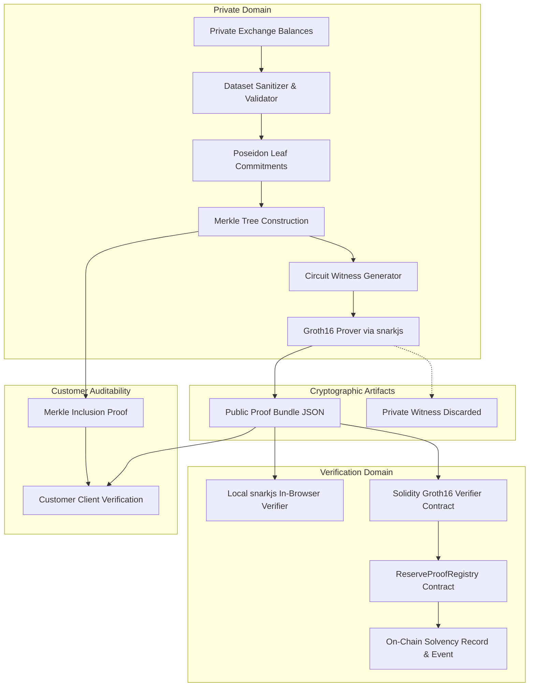

# ReserveProof System Architecture

## 1. High-Level Architecture Overview

ReserveProof is structured as a privacy-preserving cryptographic audit framework designed to verify solvency without disclosing individual user financial balances.



---

## 2. Monorepo Structure and Responsibilities

The codebase is organized as an npm workspaces monorepo:

```
reserveproof/
├── apps/
│   └── web/                   # Next.js 14 App Router fintech dashboard
│       ├── app/               # Routes: Overview, Data, Prove, Verify, Reports, Settings
│       ├── components/        # Neo-brutalist UI components & Recharts visualizations
│       ├── hooks/             # Wagmi & Web3 contract interaction hooks
│       └── lib/               # Client-side proving & validation helpers
├── packages/
│   ├── shared/                # Core domain types, financial math, Poseidon Merkle tree
│   │   ├── src/types.ts       # Shared TypeScript interfaces & PublicProofBundle
│   │   ├── src/financial.ts   # Safe 64-bit integer arithmetic & satoshi formatting
│   │   ├── src/merkle.ts      # Depth-4 Poseidon Merkle tree implementation
│   │   ├── src/generator.ts   # Deterministic synthetic customer data generator
│   │   └── src/validation.ts  # Zod schemas & bundle sanitization
│   ├── zk/                    # Circom circuits, Groth16 scripts, trusted setup
│   │   ├── circuits/          # solvency.circom (16-leaf capacity)
│   │   ├── scripts/           # compile.js, setup-dev.js, prove.js, verify.js
│   │   ├── artifacts/         # solvency.wasm, solvency_final.zkey, verification_key.json
│   │   └── test/              # Circuit constraint & security test suite
│   └── contracts/             # Solidity smart contracts & Hardhat 3 suite
│       ├── contracts/         # Verifier.sol, ReserveProofRegistry.sol
│       ├── scripts/           # deploy.ts
│       └── test/              # Mocha/Chai contract verification tests
├── docs/                      # Technical, threat, and cryptographic documentation
└── bin/                       # Local binaries (circom.exe for Windows)
```

---

## 3. Data Flow and Component Interactions

### Phase 1: Private Snapshot & Commitment Generation
1. The operator selects or generates a customer balance snapshot (16 customer accounts).
2. Each account is hashed into a leaf commitment:
   $$\text{Leaf}_i = \text{Poseidon}(\text{customerIdNum}_i, \text{balanceSatoshis}_i, \text{salt}_i, \text{datasetVersion})$$
3. A 4-level binary Merkle tree is computed, yielding the public `merkleRoot`.

### Phase 2: Zero-Knowledge Proving
1. The private inputs (`customerId`, `balance`, `salt`) and public inputs (`merkleRoot`, `totalLiabilities`, `declaredReserves`, `datasetVersion`) are passed into the Circom compiled WASM witness generator.
2. The witness is evaluated against the R1CS constraint system.
3. `snarkjs.groth16.prove` produces the proof coordinates $(A \in G_1, B \in G_2, C \in G_1)$.
4. The public proof bundle is generated and sanitized to strictly guarantee that no private witness data or customer balances are included.

### Phase 3: Dual Verification
1. **Local Verification**:
   The public bundle is verified offline or in-browser using `verification_key.json` and `snarkjs.groth16.verify()`.
2. **On-Chain Verification**:
   The user/operator calls `submitSolvencyProof(a, b, c, publicInputs)` on `ReserveProofRegistry.sol`. The contract verifies the proof via `Groth16Verifier.sol` and records an immutable on-chain solvency report.
